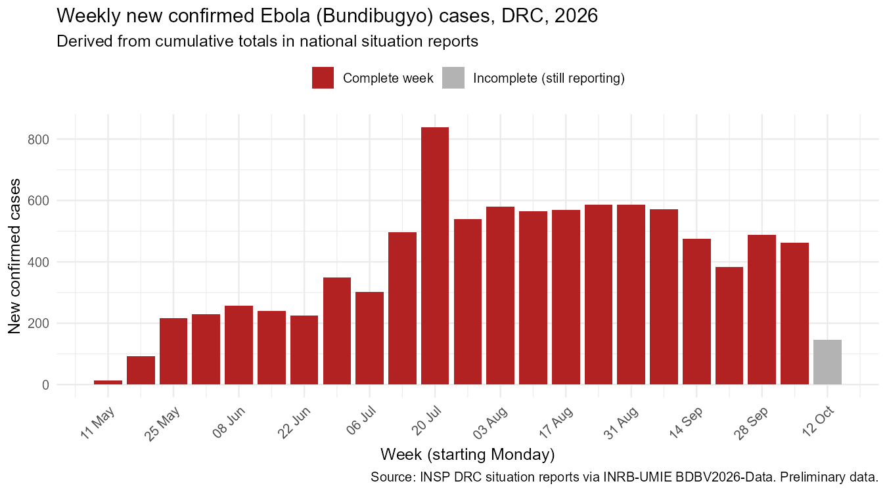
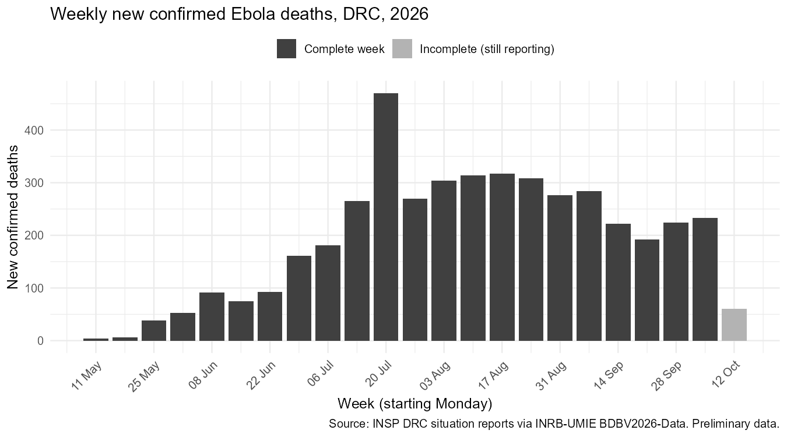

# Ebola (Bundibugyo) Outbreak, DRC 2026: Descriptive Surveillance Analysis

**Author:** Jackline Lagat, Environmental Health graduate and IDSR Intern (Port Health), Jomo Kenyatta International Airport
**Tools:** R (tidyverse, lubridate, ggplot2)

## Why this project
In May 2026, an outbreak of Bundibugyo virus disease (a species of Ebola) was confirmed in the Democratic Republic of the Congo and Uganda. As an IDSR intern doing point-of-entry surveillance at Jomo Kenyatta International Airport, I wanted to understand how the outbreak has evolved over time and what that means for cross-border screening in East Africa.

## Data
- **Source:** [INRB-UMIE BDBV2026-Data](https://github.com/INRB-UMIE/Ebola_DRC_2026), transcribed from the DRC Institut National de Santé Publique (INSP) daily situation reports.
- **Files used:** national cumulative confirmed cases and confirmed deaths, by report date (14 May to 13 October 2026).
- Data are **preliminary** and may be revised. This is a descriptive learning analysis, not a peer-reviewed publication.

## What I did
1. Loaded the data and treated values marked **ND (not reported)** as missing, not zero.
2. Checked data quality (number of report dates, missing values).
3. Converted cumulative totals into **weekly new cases and deaths**: for each week, I took the last running total reported and subtracted the previous week's total.
4. Built weekly epidemic curves for cases and deaths.
5. Calculated the overall case fatality ratio (CFR) among confirmed cases.

## Key findings (to 13 October 2026)

- **9,212 confirmed cases** and **4,441 confirmed deaths**.
- **Case fatality ratio: 48.2%**. About one in two confirmed patients has died.
- **May to June:** steady early growth, from 13 cases in the first week to roughly 200 to 250 new cases a week.
- **July:** rapid acceleration, with the highest weekly count (**839 new cases**) in the week starting 20 July. Part of this peak may reflect a reporting backlog.
- **August to early September:** a plateau of about 550 to 590 new cases a week, showing sustained transmission.
- **Mid-September onwards:** a gradual decline to about 380 to 490 new cases a week, but transmission is still ongoing.
- The grey bar is the current week, which is still being reported and should not be read as a real drop.

## Implications for point-of-entry surveillance
Although weekly cases have declined since mid-September, the outbreak is still producing several hundred confirmed cases a week, with a case fatality ratio close to 50% and no licensed vaccine or specific treatment for Bundibugyo virus. With high population movement and trade between the DRC, Uganda and East Africa, the risk of exported cases remains real. For points of entry such as JKIA, this supports keeping traveller screening, timely reporting through IDSR and cross-border data sharing active. A regional platform that brings outbreak trends and point-of-entry data together in one place would help port health teams prioritise screening by route and risk.

## Data quality notes and limitations
- Data are preliminary and may be revised as situation reports are updated.
- Reports are not published every day, so weekly figures depend on the last report available each week.
- Counts depend on testing and reporting capacity in affected areas.
- I compared two compilations of the same situation reports and found date errors in one (report dates shifted by several weeks for sitreps 86 to 133, checked against the original PDF file names). I used the INRB-UMIE dataset because its dates were consistent.

## How to run
1. Create an RStudio project and put the CSV files in a folder called `data`.
2. Install packages once: `install.packages(c("tidyverse", "lubridate"))`
3. Open `ebola_script.R` and click **Source**. Charts are saved to `figures/` and a weekly summary to `data/weekly_summary.csv`.

(In this repository, all files are stored in the main folder for easy viewing.)

## Next steps
- Estimate the time-varying reproduction number (Rt) using the `EpiEstim` package.
- Map cases by health zone.
- Analyse the point-of-entry screening data included in the source dataset.
- Build a simple interactive dashboard (R Shiny).

## Acknowledgement
Data credit: INSP (DRC) situation reports, compiled by INRB-UMIE. All errors in this analysis are my own.
